# Forensic Research Audit & Master Handoff Report: Automated MDD Detection via SPWVD EEG and Deep Learning

**Project Title**: Automated Detection of Major Depressive Disorder Using SPWVD-Based EEG Time-Frequency Images and Deep Learning Features  
**Auditor**: Senior EEG Signal-Processing & Machine-Learning Research Auditor  
**Date**: October 29, 2026  
**Verified Project Root**: `/Users/mayankmaurya/Desktop/experiment`  
**Target Manuscript**: `manuscript/Jha_MDD_Revised.docx` (Generated via `src/generate_revised_manuscript.py`)  
**Companion Evidence Ledger**: `reports/verified_evidence_results_ledger.csv` (108 verified result rows)  
**Git Repository**: [https://github.com/MayankMaurya27/MDD_dataset_results.git](https://github.com/MayankMaurya27/MDD_dataset_results.git) (Branch: `main`)

---

## 1. Executive Summary

This forensic audit was conducted directly inside the local project workspace (`/Users/mayankmaurya/Desktop/experiment`) to independently verify the dataset provenance, signal processing pipeline, deep transfer learning feature extraction, cross-validation isolation, baseline metrics, model improvement experiments, test suite, and manuscript claims.

### Key Audit Findings:
1. **Dataset Integrity & Resolved Contradictions (Verified)**:
   - The authoritative BIDS metadata (`participants.tsv`), participant directories, and European Data Format (`.edf`) files confirm exactly **64 unique participants**: **30 Healthy Controls** (`sub-HS1` to `sub-HS30`) and **34 MDD Patients** (`sub-MDDS1` to `sub-MDDS34`).
   - The dataset README statement claiming "34 participants (19 healthy controls and 15 MDD patients)" was an unedited template string originating from a preliminary pilot note in `code/mumtaz2016.py`. The actual filesystem and BIDS scans contain **181 recordings**.
   - Condition cohorts differ due to acquisition availability:
     - **Eyes-Closed (EC)**: **58 participants** (28 HC, 30 MDD), 58 recordings, 870 segments (15 segments/subject). 6 subjects are missing EC recordings (`sub-HS12`, `sub-HS18`, `sub-MDDS4`, `sub-MDDS8`, `sub-MDDS12`, `sub-MDDS16`).
     - **Eyes-Open (EO)**: **61 unique participants** (29 HC, 32 MDD), 62 recordings, 930 segments. Subject `sub-HS15` performed 2 separate runs (30 segments total); both runs were strictly quarantined into Fold 3.
     - **P300 Task**: **61 unique participants**, 61 recordings (unprocessed in current baseline).
2. **Cross-Validation & Data Leakage (Verified Zero Participant Contamination)**:
   - A deterministic Stratified Group 10-Fold Cross-Validation scheme (`seed=42`) was implemented. All recordings and segments belonging to the same participant are strictly quarantined to a single test fold.
   - Zero participant overlap exists between training and testing folds ($train \cap test = \emptyset$).
   - `StandardScaler` feature normalization is fit strictly inside the training fold loop; zero test feature statistics contaminate the scalers.
   - Pretrained CNN backbones (ResNet-18, ResNet-50, AlexNet, VGG-16) were evaluated strictly in frozen inference mode without fine-tuning on EEG data.
3. **Verified Diagnostic Metrics Reconciled from Raw Out-of-Fold (OOF) Predictions**:
   - **Eyes-Closed Cohort ($N=58$)**:
     - **Linear SVM (Fixed Baseline)**: **89.66%** pooled accuracy, **93.33%** sensitivity (28/30 MDD), **85.71%** specificity (24/28 HC), **90.32%** F1-score, **95.36%** ROC-AUC ($\text{TN}=24, \text{FP}=4, \text{FN}=2, \text{TP}=28$). Fold mean accuracy: $89.90 \pm 8.34\%$ ($\text{ddof}=0$) or $\pm 8.79\%$ ($\text{ddof}=1$).
     - **Medium Gaussian SVM & Neural Network (MLP)**: **89.66%** pooled accuracy, **90.00%** sensitivity, **89.29%** specificity, **90.00%** F1-score, **93.57%–94.40%** ROC-AUC ($\text{TN}=25, \text{FP}=3, \text{FN}=3, \text{TP}=27$).
     - **Fine Gaussian SVM**: **50.00%** accuracy ($\text{TN}=3, \text{FP}=25, \text{FN}=4, \text{TP}=26$), exhibiting catastrophic overfitting in 512-D space.
   - **Eyes-Open Cohort ($N=61$)**:
     - **Medium Gaussian SVM & Neural Network**: **91.80%** pooled accuracy, **90.62%** sensitivity (29/32 MDD), **93.10%** specificity (27/29 HC), **92.06%** F1-score, **93.32%–96.01%** ROC-AUC ($\text{TN}=27, \text{FP}=2, \text{FN}=3, \text{TP}=29$). Fold mean accuracy: $91.48 \pm 12.49\%$ ($\text{ddof}=0$).
     - **Linear, Quadratic, Cubic SVM, Weighted KNN**: **88.52%** pooled accuracy ($\text{TN}=25, \text{FP}=4, \text{FN}=3, \text{TP}=29$).
4. **Model Improvement Experiments & Model Selection Bias Audit**:
   - **Experiment 1 (Aggregation)**: Median aggregation on EC Linear SVM reached 91.38% (+1.72%), but this was evaluated post-hoc on outer-fold predictions (**Exploratory**).
   - **Experiment 2 (Channel Weighting)**: Frontal 2× weighting on Medium Gaussian SVM reached 91.38% (+1.72%), specificity 92.86% (**Exploratory**).
   - **Experiment 3 (SPWVD Smoothing)**: Kaiser window ($\beta=7.0$) reached 93.10% on Linear SVM with 100% sensitivity (30/30 MDD) (**Exploratory**).
   - **Experiment 4 (Nested Cross-Validation)**: A genuine inner 5-fold Stratified Group CV was conducted on training folds only. Nested Linear SVM selected $C \in [0.01, 0.1]$ and achieved **91.38% unbiased outer-test accuracy** (sensitivity 93.33%, specificity 89.29%, ROC-AUC 94.76%, $\text{TN}=25, \text{FP}=3, \text{FN}=2, \text{TP}=28$) (**Confirmatory**).
5. **Manuscript & Citation Audit Findings**:
   - The manuscript (`manuscript/Jha_MDD_Revised.docx`) accurately reflects the 58 vs. 61 participant counts and withheld literature comparison table.
   - However, the manuscript contains **inflated claims** (e.g. "clinical readiness", "universal superiority", "true diagnostic accuracy") that must be tempered.
   - **Citation Audit**: 4 references are questionable self-citations ([2], [5], [19], [20]), Reference [17] is misattributed to conformal kernel SVM (actually Shen et al. on kernel-target alignment), Reference [21] cites a transfer learning book chapter for ImageNet instead of Deng et al., and Reference [16] cites Acharya's 2015 nonlinear features paper while describing a CNN.

---

## 2. Project Root & Comprehensive File Inventory

**Root Path**: `/Users/mayankmaurya/Desktop/experiment`

| Relative Path | File Type | Size | Role / Description | Inspected Status | Importance |
| :--- | :--- | :--- | :--- | :--- | :--- |
| `nm000114_v1.0.0/` | Directory | ~1.4 GB | BIDS raw dataset (64 subjects, 181 EDF files) | Verified | Critical |
| `nm000114_v1.0.0/participants.tsv` | TSV | 1.8 KB | Authoritative BIDS metadata for 64 subjects | Verified | Critical |
| `nm000114_v1.0.0/dataset_description.json` | JSON | 512 B | Dataset DOI (`10.82901/nemar.nm000114`), license | Verified | High |
| `nm000114_v1.0.0/README.md` | Markdown | 4.2 KB | Original BIDS README with 34-subject text note | Verified | Medium |
| `src/audit_dataset.py` | Python | 5.3 KB | Script verifying BIDS structure and EDF headers | Verified | High |
| `src/preprocessing.py` | Python | 3.7 KB | MNE loader, 19 10-20 channels, 2.0s segmentation | Verified | Critical |
| `src/spwvd.py` | Python | 4.2 KB | Analytic Hilbert, Hamming/Kaiser smoothing, RGB | Verified | Critical |
| `src/feature_extractor.py` | Python | 3.5 KB | PyTorch frozen extractors (ResNet-18/50, Alex, VGG) | Verified | Critical |
| `src/extract_features.py` | Python | 5.1 KB | Batch feature extraction and caching runner | Verified | High |
| `src/classifiers.py` | Python | 2.6 KB | 8 scikit-learn classifiers with Platt calibration | Verified | Critical |
| `src/evaluation.py` | Python | 2.8 KB | Participant probability mean aggregation & metrics | Verified | Critical |
| `src/generate_folds.py` | Python | 3.2 KB | Stratified Group 10-Fold CV generator (seed=42) | Verified | Critical |
| `src/run_experiments.py` | Python | 13 KB | Main 10-fold CV baseline experiment runner | Verified | Critical |
| `src/run_improvement_experiments.py` | Python | 31 KB | Experiments 1–4 (aggregation, montage, nested CV) | Verified | Critical |
| `src/generate_revised_manuscript.py` | Python | 40 KB | Programmatic DOCX manuscript generator | Verified | Critical |
| `src/smoke_test.py` | Python | 3.7 KB | Fast pipeline sanity check script | Verified | Medium |
| `tests/test_pipeline.py` | Python | 6.8 KB | 6 pytest verification tests (all passing) | Verified | High |
| `manuscript/Jha_MDD_Revised.docx` | DOCX | 49 KB | Current revised manuscript document | Verified | Critical |
| `original_manuscript_text.txt` | Text | 35 KB | Plain text dump of original unrevised draft | Verified | Medium |
| `phase1_audit_docx_text.txt` | Text | 35 KB | Phase 1 preliminary audit notes | Verified | Medium |
| `FINAL_EXPERIMENT_AND_REVISION_REPORT.md` | Markdown | 23 KB | Previous comprehensive synthesis report | Verified | High |
| `README.md` | Markdown | 5.5 KB | Project documentation & setup instructions | Verified | High |
| `requirements.txt` | Text | 843 B | Python dependencies (mne, torch, torchvision, etc.) | Verified | High |
| `.gitignore` | Text | 365 B | Git exclusions (excludes dataset, venv, pycache) | Verified | High |
| `reports/dataset_inventory.csv` | CSV | 25 KB | Per-recording inventory (181 scans) | Verified | Critical |
| `reports/dataset_audit.md` | Markdown | 8.8 KB | Phase 1 dataset audit documentation | Verified | High |
| `reports/data_quality_report.md` | Markdown | 5.9 KB | EEG signal quality and sampling rate report | Verified | Medium |
| `reports/experimental_protocol.md` | Markdown | 7.5 KB | 10-fold CV leakage prevention protocol | Verified | High |
| `reports/final_baseline_verification.md` | Markdown | 10 KB | Baseline verification report | Verified | High |
| `reports/results_reconciliation.md` | Markdown | 12 KB | Resolution of 58 vs 61 participant counts | Verified | High |
| `reports/model_improvement_experiments.md` | Markdown | 16 KB | Complete report on Experiments 1–4 | Verified | High |
| `reports/citation_audit.csv` | CSV | 10 KB | Full audit of all 21 manuscript references | Verified | Critical |
| `reports/verified_evidence_results_ledger.csv` | CSV | 16 KB | Newly created machine-readable results ledger | Verified | Critical |
| `results/fold_assignments.csv` | CSV | 2.6 KB | 64-subject fold mappings (Folds 0–9) | Verified | Critical |
| `results/baseline/out_of_fold_predictions_eyesClosed.csv` | CSV | 477 KB | 6,960 segment OOF predictions for EC | Verified | Critical |
| `results/baseline/out_of_fold_predictions_eyesOpen.csv` | CSV | 497 KB | 7,440 segment OOF predictions for EO | Verified | Critical |
| `results/baseline/metrics_summary_eyesClosed.csv` | CSV | 1.9 KB | 12 summary metric rows for EC baseline | Verified | Critical |
| `results/baseline/metrics_summary_eyesOpen.csv` | CSV | 1.8 KB | 12 summary metric rows for EO baseline | Verified | Critical |
| `results/baseline/fold_metrics_eyesClosed.csv` | CSV | 7.3 KB | Fold-by-fold metrics across 10 folds (EC) | Verified | High |
| `results/baseline/fold_metrics_eyesOpen.csv` | CSV | 7.2 KB | Fold-by-fold metrics across 10 folds (EO) | Verified | High |
| `results/baseline/experiment_config.yaml` | YAML | 2.6 KB | Frozen configuration for baseline reproduction | Verified | High |
| `results/confusion_matrices/` | Directory | ~1.4 MB | 16 condition-tagged confusion matrix PNGs | Verified | High |
| `results/features_cache/metadata_eyesClosed.csv` | CSV | 39 KB | 870 segment metadata entries (EC) | Verified | Critical |
| `results/features_cache/metadata_eyesOpen.csv` | CSV | 40 KB | 930 segment metadata entries (EO) | Verified | Critical |
| `results/features_cache/features_resnet18_eyesClosed.npy` | NumPy | 1.7 MB | Extracted ResNet-18 features (870, 512) | Verified | High |
| `results/features_cache/features_resnet18_eyesOpen.npy` | NumPy | 1.8 MB | Extracted ResNet-18 features (930, 512) | Verified | High |
| `results/experiments/exp1_aggregation/` | Directory | 8 KB | CSVs for epoch aggregation alternatives | Verified | High |
| `results/experiments/exp2_channel_weighting/` | Directory | 1.7 MB | CSVs & feature cache for frontal montage | Verified | High |
| `results/experiments/exp3_spwvd_smoothing/` | Directory | 4 KB | CSVs for Kaiser window smoothing variants | Verified | High |
| `results/experiments/exp4_nested_tuning/` | Directory | 12 KB | CSVs for inner/outer nested CV tuning | Verified | Critical |

---

## 3. Dataset Provenance & Verified Participant Counts

### 3.1 Provenance and Metadata
- **Accession Identifier**: OpenNeuro / NEMAR `nm000114_v1.0.0`
- **Permanent DOI**: [`10.82901/nemar.nm000114`](https://doi.org/10.82901/nemar.nm000114)
- **Source Data DOI**: [`10.6084/m9.figshare.4244171.v2`](https://doi.org/10.6084/m9.figshare.4244171.v2) (Mumtaz, Figshare 2016)
- **Primary Clinical Study**: Mumtaz et al., *Biomedical Signal Processing and Control*, vol. 31, pp. 108–115, 2017.
- **License**: Creative Commons Attribution 4.0 International (CC-BY-4.0).
- **Format**: BIDS version 1.7.0 (`derivative` type). Converted via MNE-BIDS 0.17.0.
- **Acquisition Center**: Hospital Universiti Sains Malaysia (HUSM).

### 3.2 Participant and Recording Inventory Verification
Authoritative metadata parsed from `nm000114_v1.0.0/participants.tsv` and all individual `*_scans.tsv` files:
- **Total Unique Participants on Disk**: Exactly **64 participants**:
  - **Healthy Controls (HC)**: 30 participants (`sub-HS1` through `sub-HS30`, numeric label `0`).
  - **MDD Patients**: 34 participants (`sub-MDDS1` through `sub-MDDS34`, numeric label `1`).
- **Total EDF Recording Files on Disk**: Exactly **181 recordings**.
- **Hardware & Sampling Specs**:
  - Sampling Rate: 256 Hz.
  - Channels: 19 standard International 10-20 channels (`Fp1`, `F3`, `C3`, `P3`, `O1`, `F7`, `T3`, `T5`, `Fz`, `Fp2`, `F4`, `C4`, `P4`, `O2`, `F8`, `T4`, `T6`, `Cz`, `Pz`) + 3 bipolar auxiliary derivations (`A2-A1`, `23A-23R`, `24A-24R`).
  - Hardware filtering: 0.5–70 Hz bandpass with 50 Hz notch.

### 3.3 Task-Specific Cohort Breakdown & Missing Recording Identification
| Condition / Task | Usable Recordings | Unique Participants | HC Count | MDD Count | Segments Analyzed | Missing Participants from 64-Subject Total | Notes |
| :--- | :---: | :---: | :---: | :---: | :---: | :--- | :--- |
| **Eyes-Closed (EC)** | 58 | 58 | 28 | 30 | 870 | `sub-HS12`, `sub-HS18`, `sub-MDDS4`, `sub-MDDS8`, `sub-MDDS12`, `sub-MDDS16` (6 subjects) | Exactly 1 recording per participant; 15 segments/rec. |
| **Eyes-Open (EO)** | 62 | 61 | 29 | 32 | 930 | `sub-HS25`, `sub-MDDS7`, `sub-MDDS8` (3 subjects) | `sub-HS15` has 2 runs (`run-1`, `run-2`), generating 30 segments; all other 60 subjects have 15 segments. |
| **Auditory P300** | 61 | 61 | 28 | 33 | — | `sub-HS20`, `sub-HS21`, `sub-MDDS9` (3 subjects) | Task-based oddball; excluded from resting-state baseline. |

### 3.4 Resolution of the 34 vs. 64 Contradiction
- In `nm000114_v1.0.0/README.md`, text states: *"The dataset includes 34 participants (19 healthy controls and 15 MDD patients)..."*
- **Resolution**: Forensic inspection of `code/mumtaz2016.py` reveals that the BIDS converter hardcoded an unedited string from an earlier pilot. The authoritative BIDS metadata `participants.tsv`, the filesystem directories, and the scans inventory all confirm **64 participants (30 HC, 34 MDD)**. The manuscript's claim of 64 participants is **physically verified and correct**.

---

## 4. Reconstructed Experimental Pipeline

```mermaid
flowchart TD
    A["Raw BIDS EDF Recording (256 Hz)"] --> B["Preprocessing: MNE Bandpass Filter (0.5 - 45.0 Hz)"]
    B --> C["Channel Standardization (19 Standard 10-20 Electrodes)"]
    C --> D["Fixed Segmentation: 2.0s Windows (512 Samples, 0% Overlap)"]
    D --> E["Uniform Sampling: Exactly 15 Windows per Recording"]
    E --> F["Analytic Signal Computation (Hilbert Transform)"]
    F --> G["SPWVD: Hamming Time (L=31) + Kaiser Lag (L=255, beta=5.0)"]
    G --> H["Channel Energy Averaging across 19 Electrodes -> 2D SPWVD"]
    H --> I["Robust Normalization: Clip >=0, Scale by 99.5th Percentile"]
    I --> J["Interpolation to (224, 224, 3) + ImageNet Mean/Std Normalization"]
    J --> K["Frozen CNN Feature Extraction (ResNet-18: 512-D)"]
    K --> L["Stratified Group 10-Fold Split (Participant Isolation)"]
    L --> M["Training-Only StandardScaler (Fitted on Train Fold Only)"]
    M --> N["Supervised Classifiers (Platt-Calibrated SVM, KNN, MLP, RF)"]
    N --> O["Segment Posterior Probability Inference: P(MDD | Segment)"]
    O --> P["Participant-Level Aggregation: Arithmetic Mean Probability"]
    P --> Q["Diagnostic Threshold: Mean Prob >= 0.5 -> MDD"]
```



### Detailed Pipeline Parameters:
1. **Signal Loading**: `src/preprocessing.py::load_eeg_recording` reads raw EDF files, maps bipolar electrode labels to 19 standard monopolar channels, applies zero-phase FIR bandpass filtering (0.5–45.0 Hz), and converts units from Volts to microvolts ($\mu\text{V}$).
2. **Segmentation**: `src/preprocessing.py::segment_recording` segments continuous signals into 2.0-second epochs ($512$ samples at $256$ Hz) with $0.0\%$ overlap. In `src/extract_features.py`, if a recording yields $>15$ segments, exactly 15 segments are extracted at evenly spaced intervals across the duration.
3. **SPWVD Computation**: `src/spwvd.py::compute_spwvd` constructs the analytic signal $z(t) = x(t) + j\mathcal{H}\{x(t)\}$. Cross-terms are attenuated using a 31-point Hamming window $g(t)$ along the time axis and a 255-point Kaiser window $h(\tau)$ ($\beta=5.0$) along the lag axis. An FFT of size $N_{\text{fft}}=256$ yields 128 positive frequency bins ($0$ to $128$ Hz).
4. **Channel Fusion**: Standard baseline averages the 2D SPWVD power matrices uniformly across all 19 channels: $\bar{W}(t, f) = \frac{1}{19}\sum_{c=1}^{19} W_c(t, f)$.
5. **Image Standardisation**: `src/spwvd.py::spwvd_to_rgb_image` sets negative values to 0, divides by the 99.5th percentile, resizes to $(224, 224)$ via bilinear interpolation, replicates across 3 channels, and normalizes using ImageNet channel statistics ($\mu = [0.485, 0.456, 0.406]$, $\sigma = [0.229, 0.224, 0.225]$).
6. **Feature Extraction**: `src/feature_extractor.py::DeepFeatureExtractor` passes normalized tensors through frozen pretrained PyTorch models. For ResNet-18, the classification head `fc` is replaced with `nn.Identity()`, extracting a 512-dimensional embedding vector per segment.
7. **Cross-Validation**: `src/generate_folds.py::generate_folds` partitions participants into 10 folds using `np.random.RandomState(42)`. Exactly 3 HC participants are assigned to every fold; Folds 0–3 receive 4 MDD participants and Folds 4–9 receive 3 MDD participants.
8. **Participant Aggregation**: `src/evaluation.py::aggregate_participant_predictions` averages predicted segment probabilities for each participant: $\bar{P}_i = \frac{1}{K}\sum_{k=1}^K P(y=1 \mid \mathbf{x}_{i,k})$. The participant is classified as MDD if $\bar{P}_i \ge 0.50$.

---

## 5. Cross-Validation & Data Leakage Audit

### 5.1 Participant-Level Independence (Verified Zero Participant Leakage)
A forensic check was performed on `results/fold_assignments.csv`, `results/features_cache/metadata_eyesClosed.csv`, and `results/features_cache/metadata_eyesOpen.csv`:
- **Fold Mutual Exclusivity**: For every fold $f \in \{0, \dots, 9\}$, the intersection of participants in the training set and testing set was evaluated:
  $$\text{Participants}_{\text{train}} \cap \text{Participants}_{\text{test}} = \emptyset$$
  **Finding**: **0 overlapping participants across all 10 folds**.
- **Participant Segment Quarantine**: In both eyes-closed (870 segments) and eyes-open (930 segments), every segment from a given participant is assigned to the exact same fold.
- **Handling of Repeated Runs (`sub-HS15`)**: Subject `sub-HS15` has two recording sessions in the eyes-open condition (`run-1` and `run-2`, totaling 30 segments). Both runs are mapped to Fold 3. Zero segments from `sub-HS15` leak into Folds 0–2 or 4–9.

### 5.2 Preprocessing and Transformation Leakage Check
- **Scaler Isolation**: In `src/run_experiments.py` (lines 107–108, 241–242) and `src/run_improvement_experiments.py` (lines 534–535, 574–575), `StandardScaler` is initialized and fitted strictly inside the outer training fold loop:
  ```python
  scaler = StandardScaler()
  X_train_scaled = scaler.fit_transform(X_train)
  X_test_scaled = scaler.transform(X_test)
  ```
  Zero test segments or test participants are seen during mean and standard deviation fitting.
- **Deep Feature Extractor Isolation**: Feature extraction uses off-the-shelf ImageNet pretrained weights. Backbones were frozen (`param.requires_grad = False`). No supervised or unsupervised adaptation was performed on EEG features, precluding representation leakage.

### 5.3 Model-Selection Bias vs. Data Leakage
A critical distinction must be drawn between **participant-level leakage** and **model-selection bias**:
- **Participant-level leakage**: Evaluated and ruled out. The folds are strictly participant-independent.
- **Model-selection bias**:
  - In Experiments 1, 2, and 3, multiple variants (e.g. mean vs. median aggregation, uniform vs. frontal weighting, standard vs. Kaiser SPWVD) were evaluated on the **outer test folds**. Choosing the highest-scoring variant from outer-fold results introduces post-hoc selection bias.
  - In Experiment 4 (Nested Cross-Validation), hyperparameter tuning was conducted via an **inner 5-fold Stratified Group CV** on the training fold only. Outer test folds were held out completely until the winning configuration was selected, ensuring unbiased reporting.

---

## 6. Baseline Results Reconciled Against Raw Artifacts

The baseline metrics were recomputed directly from the out-of-fold prediction files (`results/baseline/out_of_fold_predictions_eyesClosed.csv` and `results/baseline/out_of_fold_predictions_eyesOpen.csv`) and compared against summary CSVs, fold CSVs, and manuscript tables.

### 6.1 Convention and Definitions
- **Class Convention**: Positive class ($1$) = Major Depressive Disorder (MDD); Negative class ($0$) = Healthy Control (HC).
- **Confusion Matrix**: $\text{TN}$ = Correct HC, $\text{FP}$ = HC misclassified as MDD, $\text{FN}$ = MDD misclassified as HC, $\text{TP}$ = Correct MDD.
- **Metrics**: Accuracy $= \frac{\text{TP}+\text{TN}}{N}$, Sensitivity $= \frac{\text{TP}}{\text{TP}+\text{FN}}$, Specificity $= \frac{\text{TN}}{\text{TN}+\text{FP}}$, Precision $= \frac{\text{TP}}{\text{TP}+\text{FP}}$, $\text{F1} = \frac{2\text{TP}}{2\text{TP}+\text{FP}+\text{FN}}$.
- **Standard Deviation**: Two definitions exist:
  - $\text{ddof}=0$ (population standard deviation, default `np.std` used in `run_experiments.py` summary CSVs).
  - $\text{ddof}=1$ (sample standard deviation, default in statistical reporting).
  Both values are provided below for full clarity.

### 6.2 Primary Baseline Results Table: Eyes-Closed Cohort ($N = 58$: 28 HC, 30 MDD)
*All models evaluated with ResNet-18 features (512-D), uniform 19-channel SPWVD, and arithmetic mean probability aggregation.*

| Classifier | Eval Unit | $N_{\text{HC}}$ | $N_{\text{MDD}}$ | TN | FP | FN | TP | Accuracy (%) | Sensitivity (%) | Specificity (%) | Precision (%) | F1-Score (%) | ROC-AUC (%) | Fold Mean Acc (%) | Fold SD ($\text{ddof}=0$) | Fold SD ($\text{ddof}=1$) | Artifact Source | Status |
| :--- | :--- | :---: | :---: | :---: | :---: | :---: | :---: | :---: | :---: | :---: | :---: | :---: | :---: | :---: | :---: | :---: | :--- | :---: |
| **Linear SVM** | Participant | 28 | 30 | 24 | 4 | 2 | 28 | **89.66** | **93.33** | **85.71** | **87.50** | **90.32** | **95.36** | 89.90 | $\pm 8.34$ | $\pm 8.79$ | `results/baseline/out_of_fold_predictions_eyesClosed.csv` | **Verified** |
| **Medium Gaussian SVM** | Participant | 28 | 30 | 25 | 3 | 3 | 27 | **89.66** | **90.00** | **89.29** | **90.00** | **90.00** | **93.57** | 89.90 | $\pm 11.19$ | $\pm 11.79$ | `results/baseline/out_of_fold_predictions_eyesClosed.csv` | **Verified** |
| **Neural Network (MLP)** | Participant | 28 | 30 | 25 | 3 | 3 | 27 | **89.66** | **90.00** | **89.29** | **90.00** | **90.00** | **94.40** | 89.90 | $\pm 11.19$ | $\pm 11.79$ | `results/baseline/out_of_fold_predictions_eyesClosed.csv` | **Verified** |
| **Cubic SVM** | Participant | 28 | 30 | 24 | 4 | 2 | 28 | **89.66** | **93.33** | **85.71** | **87.50** | **90.32** | **92.74** | 89.90 | $\pm 11.19$ | $\pm 11.79$ | `results/baseline/out_of_fold_predictions_eyesClosed.csv` | **Verified** |
| **Quadratic SVM** | Participant | 28 | 30 | 23 | 5 | 2 | 28 | **87.93** | **93.33** | **82.14** | **84.85** | **88.89** | **90.95** | 88.24 | $\pm 10.79$ | $\pm 11.38$ | `results/baseline/out_of_fold_predictions_eyesClosed.csv` | **Verified** |
| **Weighted KNN** | Participant | 28 | 30 | 24 | 4 | 4 | 26 | **86.21** | **86.67** | **85.71** | **86.67** | **86.67** | **92.14** | 86.57 | $\pm 10.11$ | $\pm 10.66$ | `results/baseline/out_of_fold_predictions_eyesClosed.csv` | **Verified** |
| **Ensemble Bagged Tree**| Participant | 28 | 30 | 22 | 6 | 2 | 28 | **86.21** | **93.33** | **78.57** | **82.35** | **87.50** | **91.43** | 86.81 | $\pm 14.06$ | $\pm 14.82$ | `results/baseline/out_of_fold_predictions_eyesClosed.csv` | **Verified** |
| **Fine Gaussian SVM** | Participant | 28 | 30 | 3 | 25 | 4 | 26 | **50.00** | **86.67** | **10.71** | **50.98** | **64.20** | **42.74** | 49.71 | $\pm 9.52$ | $\pm 10.03$ | `results/baseline/out_of_fold_predictions_eyesClosed.csv` | **Verified** |

### 6.3 Primary Baseline Results Table: Eyes-Open Cohort ($N = 61$: 29 HC, 32 MDD)
| Classifier | Eval Unit | $N_{\text{HC}}$ | $N_{\text{MDD}}$ | TN | FP | FN | TP | Accuracy (%) | Sensitivity (%) | Specificity (%) | Precision (%) | F1-Score (%) | ROC-AUC (%) | Fold Mean Acc (%) | Fold SD ($\text{ddof}=0$) | Fold SD ($\text{ddof}=1$) | Artifact Source | Status |
| :--- | :--- | :---: | :---: | :---: | :---: | :---: | :---: | :---: | :---: | :---: | :---: | :---: | :---: | :---: | :---: | :---: | :--- | :---: |
| **Medium Gaussian SVM** | Participant | 29 | 32 | 27 | 2 | 3 | 29 | **91.80** | **90.62** | **93.10** | **93.55** | **92.06** | **93.32** | 91.48 | $\pm 12.49$ | $\pm 13.16$ | `results/baseline/out_of_fold_predictions_eyesOpen.csv` | **Verified** |
| **Neural Network (MLP)** | Participant | 29 | 32 | 27 | 2 | 3 | 29 | **91.80** | **90.62** | **93.10** | **93.55** | **92.06** | **96.01** | 91.48 | $\pm 12.49$ | $\pm 13.16$ | `results/baseline/out_of_fold_predictions_eyesOpen.csv` | **Verified** |
| **Linear SVM** | Participant | 29 | 32 | 25 | 4 | 3 | 29 | **88.52** | **90.62** | **86.21** | **87.88** | **89.23** | **95.69** | 88.14 | $\pm 11.98$ | $\pm 12.63$ | `results/baseline/out_of_fold_predictions_eyesOpen.csv` | **Verified** |
| **Quadratic SVM** | Participant | 29 | 32 | 25 | 4 | 3 | 29 | **88.52** | **90.62** | **86.21** | **87.88** | **89.23** | **95.26** | 88.14 | $\pm 11.98$ | $\pm 12.63$ | `results/baseline/out_of_fold_predictions_eyesOpen.csv` | **Verified** |
| **Cubic SVM** | Participant | 29 | 32 | 25 | 4 | 3 | 29 | **88.52** | **90.62** | **86.21** | **87.88** | **89.23** | **92.56** | 88.14 | $\pm 14.11$ | $\pm 14.87$ | `results/baseline/out_of_fold_predictions_eyesOpen.csv` | **Verified** |
| **Weighted KNN** | Participant | 29 | 32 | 25 | 4 | 3 | 29 | **88.52** | **90.62** | **86.21** | **87.88** | **89.23** | **94.61** | 88.14 | $\pm 11.98$ | $\pm 12.63$ | `results/baseline/out_of_fold_predictions_eyesOpen.csv` | **Verified** |
| **Ensemble Bagged Tree**| Participant | 29 | 32 | 24 | 5 | 3 | 29 | **86.89** | **90.62** | **82.76** | **85.29** | **87.88** | **93.43** | 86.48 | $\pm 13.59$ | $\pm 14.32$ | `results/baseline/out_of_fold_predictions_eyesOpen.csv` | **Verified** |
| **Fine Gaussian SVM** | Participant | 29 | 32 | 1 | 28 | 1 | 31 | **52.46** | **96.88** | **3.45** | **52.54** | **68.13** | **44.07** | 51.86 | $\pm 10.64$ | $\pm 11.21$ | `results/baseline/out_of_fold_predictions_eyesOpen.csv` | **Verified** |

### 6.4 CNN Architecture Comparison (Evaluated with Weighted KNN Classifier)
| Architecture | Condition | Feat Dim | Pooled Acc (%) | Sensitivity (%) | Specificity (%) | F1-Score (%) | ROC-AUC (%) | Fold Mean Acc (%) | Fold SD ($\text{ddof}=0$) | Status |
| :--- | :--- | :---: | :---: | :---: | :---: | :---: | :---: | :---: | :---: | :---: |
| **ResNet-18** | Eyes-Closed | 512 | **86.21** | 86.67 | 85.71 | 86.67 | 92.14 | 86.57 | $\pm 10.11$ | **Verified** |
| **ResNet-50** | Eyes-Closed | 2048 | **84.48** | 93.33 | 75.00 | 86.15 | 90.48 | 84.81 | $\pm 11.19$ | **Verified** |
| **AlexNet** | Eyes-Closed | 4096 | **81.03** | 86.67 | 75.00 | 82.54 | 89.29 | 81.81 | $\pm 15.34$ | **Verified** |
| **VGG-16** | Eyes-Closed | 4096 | **79.31** | 70.00 | 89.29 | 77.78 | 90.71 | 78.90 | $\pm 11.00$ | **Verified** |
| **ResNet-50** | Eyes-Open | 2048 | **90.16** | 87.50 | 93.10 | 90.32 | 94.07 | 89.81 | $\pm 12.35$ | **Verified** |
| **ResNet-18** | Eyes-Open | 512 | **88.52** | 90.62 | 86.21 | 89.23 | 94.61 | 88.14 | $\pm 11.98$ | **Verified** |
| **AlexNet** | Eyes-Open | 4096 | **85.25** | 96.88 | 72.41 | 87.32 | 96.88 | 85.14 | $\pm 15.30$ | **Verified** |
| **VGG-16** | Eyes-Open | 4096 | **83.61** | 93.75 | 72.41 | 85.71 | 92.67 | 83.71 | $\pm 12.43$ | **Verified** |

---

## 7. Improvement Experiments & Model-Selection-Bias Audit

All four improvement experiments in `src/run_improvement_experiments.py` were audited against their output files in `results/experiments/`:

### 7.1 Experiment 1: Epoch Probability Aggregation Strategies
- **Implementation**: Evaluated 4 aggregation strategies on segment-level probabilities across all 8 classifiers: Arithmetic Mean, Median, 10% Trimmed Mean, and Majority Vote.
- **Verified Results (Eyes-Closed, Linear SVM)**:
  - *Mean (Baseline)*: **89.66%** accuracy, 93.33% sensitivity, 85.71% specificity ($\text{TN}=24, \text{FP}=4, \text{FN}=2, \text{TP}=28$).
  - *Median Aggregation*: **91.38%** accuracy (+1.72%), 96.67% sensitivity, 85.71% specificity ($\text{TN}=24, \text{FP}=4, \text{FN}=1, \text{TP}=29$).
  - *10% Trimmed Mean*: **89.66%** accuracy (identical to baseline).
  - *Majority Vote*: **91.38%** accuracy.
- **Scientific Status**: **Exploratory**. Aggregation rules were evaluated on the outer test fold predictions. While Median improved Linear SVM, it decreased Medium Gaussian SVM ($89.66\% \to 87.93\%$) and Weighted KNN ($86.21\% \to 82.76\%$). This must be reported as an exploratory ablation rather than an established superior model.

### 7.2 Experiment 2: Frontal Spatial Montage Weighting
- **Implementation**: Weighting frontal electrodes (`Fp1`, `Fp2`, `F3`, `F4`, `F7`, `F8`) by a factor of $2.0$ relative to temporal, parietal, and occipital electrodes ($1.0$), reflecting frontal hypoactivation literature in depression.
- **Verified Results (Eyes-Closed, ResNet-18)**:
  - *Medium Gaussian SVM*: Increased from **89.66% to 91.38%** (+1.72%), specificity increased from 89.29% to **92.86%** ($\text{TN}=26, \text{FP}=2, \text{FN}=3, \text{TP}=27$).
  - *Linear SVM*: Remained at **89.66%** (identical pooled accuracy, $\text{TN}=24, \text{FP}=4, \text{FN}=2, \text{TP}=28$).
  - *Cubic SVM*: Decreased from 89.66% to 87.93% (-1.73%).
- **Scientific Status**: **Exploratory**. Provides supportive domain evidence that frontal regions drive diagnostic separation, but outer test performance should be described as an exploratory sensitivity analysis.

### 7.3 Experiment 3: Alternative SPWVD Smoothing Windows
- **Implementation**: Recomputed SPWVD images using two alternative windowing configurations:
  - *Variant A (High Suppression)*: Kaiser lag window $\beta=7.0$ (stronger cross-term attenuation).
  - *Variant B (Compact Transient)*: Hamming $L_g=15$, Kaiser $L_h=127, \beta=3.5$ (shorter transient focus).
- **Verified Results (Eyes-Closed, Linear SVM)**:
  - *Variant A (Kaiser $\beta=7.0$)*: Achieved **93.10% accuracy** (+3.44% over baseline), with **100.00% sensitivity** (30/30 MDD detected), **85.71% specificity** (24/28 HC), **93.75% F1-score**, and **94.40% ROC-AUC** ($\text{TN}=24, \text{FP}=4, \text{FN}=0, \text{TP}=30$).
  - *Variant B*: Yielded lower accuracy for Linear SVM (**82.76%**), but high accuracy for Medium Gaussian SVM (**91.38%**).
- **Scientific Status**: **Exploratory**. High-suppression Kaiser filtering shows promise in attenuating high-frequency noise, but since it was evaluated on the outer test fold, it cannot be claimed as a confirmatory benchmark without independent external validation.

### 7.4 Experiment 4: Training-Only Group-Aware Nested Hyperparameter Tuning
- **Implementation**: Genuine nested cross-validation. For each outer fold $k \in \{0, \dots, 9\}$, an **inner 5-fold Stratified Group K-Fold split** was executed strictly on the training fold ($90\%$ of data). Hyperparameter grids:
  - Linear SVM: $C \in \{0.01, 0.1, 1.0, 10.0\}$.
  - Medium Gaussian SVM: $C \in \{0.1, 1.0, 10.0\}, \gamma \in \{\text{'scale'}, 0.001, 0.01\}$.
  - Weighted KNN: $k \in \{3, 5, 7, 10, 15\}$.
  - Neural Network: $\alpha \in \{10^{-4}, 10^{-3}, 10^{-2}\}$, hidden sizes $\{(100,), (64,)\}$.
- **Inner Tuning Behavior**:
  - For Linear SVM, the inner CV selected $C=0.1$ or $C=0.01$ (stronger regularization than default $C=1.0$) across folds.
  - The winning hyperparameter was refit on the full outer training fold and evaluated once on the unseen outer test fold.
- **Verified Unbiased Outer Test Results (Eyes-Closed)**:
  - **Nested Linear SVM**: **91.38% accuracy** (+1.72% over baseline), **93.33% sensitivity** (28/30 MDD), **89.29% specificity** (25/28 HC), **91.80% F1-score**, and **94.76% ROC-AUC** ($\text{TN}=25, \text{FP}=3, \text{FN}=2, \text{TP}=28$).
  - **Nested Neural Network**: **89.66% accuracy** (identical to fixed baseline).
  - **Nested Medium Gaussian SVM**: **87.93% accuracy** (-1.73%, due to slight inner CV variance selecting small $\gamma$).
  - **Nested Weighted KNN**: **82.76% accuracy** (-3.45%, due to neighbor instability on small sample sizes).
- **Scientific Status**: **Confirmatory / Unbiased**. Because parameter selection was strictly isolated to training folds, the 91.38% outer-test accuracy of Nested Linear SVM is mathematically valid and free from test leakage.

---

## 8. Manuscript Claim Reconciliation Table

Inspecting `manuscript/Jha_MDD_Revised.docx` and `src/generate_revised_manuscript.py`:

| Section | Current Manuscript Text / Claim | Evidence Required | Supporting Artifact | Forensic Audit Status | Recommended Action |
| :--- | :--- | :--- | :--- | :---: | :--- |
| **Abstract** | "In the primary eyes-closed resting cohort (N = 58 participants: 28 controls, 30 MDD)... 89.66% participant accuracy... eyes-open (N = 61 participants)... 91.80% accuracy" | OOF prediction logs matching participant and class counts | `results/baseline/metrics_summary_eyesClosed.csv`, `metrics_summary_eyesOpen.csv` | **Verified** | **Retain verbatim**. Numerical values match raw prediction logs exactly. |
| **Abstract** | "yielding artificially inflated accuracy claims exceeding 99%... our pipeline provides an uninflated benchmark" | Literature check on published epoch-splitting claims | `reports/manuscript_claims_audit.md` | **Verified** | **Retain**, but replace "true, uninflated diagnostic accuracy" with "participant-independent diagnostic accuracy". |
| **Introduction** | "Despite promising accuracy figures reported across the literature, many published deep learning models suffer from severe data leakage" | Audit of subject overlap literature | `reports/experimental_protocol.md` | **Verified** | **Retain**. Accurate characterization of the methodological motivation. |
| **Dataset Description** | "Physical dataset comprises exactly 64 unique participants (30 healthy controls and 34 MDD patients)... 181 scans" | Physical filesystem directory and TSV check | `nm000114_v1.0.0/participants.tsv`, `dataset_inventory.csv` | **Verified** | **Retain**. Accurately explains why README says 34 while actual data has 64. |
| **Methods: SPWVD** | "Discrete SPWVD with 31-point Hamming time window and 255-point Kaiser lag window (beta=5.0)" | Source code function inspecting window parameters | `src/spwvd.py::compute_spwvd` lines 42–56 | **Verified** | **Retain**. Code exactly implements these parameters. |
| **Methods: Leakage** | "Zero inter-subject data contamination... 10-fold stratified group CV" | Participant mutual exclusivity proof | `results/fold_assignments.csv`, `tests/test_pipeline.py` | **Verified** | **Moderate language**: Replace "Zero inter-subject data contamination" with "Strict participant-independent fold isolation". |
| **Results: Table 1** | ResNet-18 (86.21%), ResNet-50 (84.48%), AlexNet (81.03%), VGG-16 (79.31%) with Weighted KNN | Architecture comparison CSV check | `results/baseline/metrics_summary_eyesClosed.csv` rows 8–11 | **Verified** | **Retain**. Exact match with raw summary files. |
| **Results: Table 2** | Linear SVM (89.66%), Medium Gaussian SVM (89.66%), Cubic SVM (89.66%), Quadratic SVM (87.93%), KNN (86.21%), Bagged Trees (86.21%), Fine Gaussian (50.00%) | Confusion matrix & summary CSV check | `results/baseline/metrics_summary_eyesClosed.csv` rows 0–7 | **Verified** | **Retain**. 100% mathematical consistency with OOF predictions. |
| **Results: Table 2 (EO)** | Medium Gaussian (91.80%), Neural Network (91.80%), Linear SVM (88.52%), Cubic (88.52%), KNN (88.52%), Bagged Trees (86.89%), Fine Gaussian (52.46%) | Confusion matrix & summary CSV check | `results/baseline/metrics_summary_eyesOpen.csv` rows 0–7 | **Verified** | **Retain**. 100% mathematical consistency with OOF predictions. |
| **Results: Section 3.3** | "Median aggregation reached 91.38%; frontal weighting reached 91.38%; Kaiser beta=7.0 reached 93.10%; nested CV reached 91.38%" | Improvement experiment CSV check | `results/experiments/` (exp1, exp2, exp3, exp4) | **Verified** | **Qualify**: Explicitly state that Experiments 1–3 are exploratory ablations, whereas Experiment 4 is a confirmatory nested CV. |
| **Discussion: Table 3** | Table 3 withheld pending verified comparator sources and protocol harmonization | Benchmark audit | `reports/results_reconciliation.md` | **Verified** | **Retain note explaining why table is withheld**. Highly professional and scientifically rigorous. |
| **Discussion** | Claims of "clinical readiness" or "deployable psychiatric diagnostic tool" | Regulatory & clinical validation standard | General clinical standards | **Unsupported** | **Revise**: Excise any claim implying immediate clinical utility; emphasize that this is a proof-of-concept benchmark requiring multi-site external validation. |

---

## 9. Citation & Bibliography Audit

Audit of all 21 references cited in `reports/citation_audit.csv` and `src/generate_revised_manuscript.py`:

| Ref ID | Manuscript In-Text Context | Current Bibliography Entry | Status | Forensic Finding | Action Required |
| :---: | :--- | :--- | :---: | :--- | :--- |
| **[1]** | Depression symptoms & global prevalence (5%) | Wanniarachchi et al., *Front. Digit. Health*, 2025 | Valid | Recent review on digital mental health. Supports clinical background. | Keep |
| **[2]** | Leading cause of disability worldwide | Gupta, *J. Data Sci. Intell. Syst.*, 2026 | **Mismatched / Self-cite** | Paper is on student stress detection, NOT global disability epidemiology. | **Replace with WHO (2023) or GBD (2019/Lancet) report** |
| **[3]** | DSM-5 2-week persistent criteria | Lenze et al., *Neuropsychopharmacology*, 2026 | Valid | Peer-reviewed MDD precision medicine review; supports DSM definition. | Keep |
| **[4]** | COVID-19 pandemic increase in depression | Zhou et al., *Sci. Rep.*, 2025 | Valid | Empirical study quantifying pandemic acceleration of depressive disorders. | Keep |
| **[5]** | EEG superior to ECG/speech | Gupta, *SPIE OWT*, 2026 | **Mismatched / Self-cite** | Paper is on TQWT for mind-wandering, not MDD vs ECG/speech comparisons. | **Replace with established EEG clinical review or tone down claim** |
| **[6]** | Visible change in delta rhythm | Yin & Li, *Front. Psychiatry*, 2024 | Valid | Review of neural oscillations in depression; supports delta rhythm change. | Keep |
| **[7]** | Frontal alpha asymmetry (FAA) biomarker | Briesemeister et al., *NeuroImage*, 2025 | Valid | Methodological paper on FAA metrics; supports alpha asymmetry biomarker. | Keep |
| **[8]** | Spectral power & coherence features | Mumtaz et al., *Comput. Biol. Med.*, 2017 | Valid | Foundational paper evaluating spectral features on this exact clinical cohort. | Keep |
| **[9]** | Wavelet decomposition & ANN (89.12%) | Faust et al., *IEEE T-BME*, 2014 | Valid | Landmark paper on wavelet-based automated EEG classification. | Keep |
| **[10]** | Nonlinear dynamics & DFA features | Hosseinifard et al., *J. Affect. Disord.*, 2013 | Valid | Rigorous evaluation of DFA and Lyapunov exponents for depression. | Keep |
| **[11]** | Common spatial patterns (81.23%) | Liao et al., *J. Neural Eng.*, 2017 | Valid | Standard CSP benchmark for major depression classification. | Keep |
| **[12]** | Genetic algorithm channel selection | Mohammadi et al., *Comput. Meth. Prog. Biomed.*, 2015 | Valid | Important study optimizing electrode montages for depression. | Keep |
| **[13]** | 13-layer deep CNN on raw EEG (>93%) | Acharya et al., *Comput. Biol. Med.*, 2018 | Valid | Foundational deep learning paper in automated depression screening. | Keep |
| **[14]** | Transformer architectures on spectrograms | Seal et al., *IEEE TBME*, 2021 | Valid | Demonstrates time-frequency deep learning on EEG signals. | Keep |
| **[15]** | MLE channel selection (ICICC 2025) | Gupta et al., *Springer ICICC*, 2025 | Valid | Recent conference paper on channel selection in EEG. | Keep (Optional to replace with journal) |
| **[16]** | Described as end-to-end CNN model | Acharya et al., *Eur. Neurol.*, 2015 | **Mismatched Methodology** | Paper is from 2015 using nonlinear features and decision trees, NOT CNNs. | **Correct text description or cite Acharya 2018 [13] for CNNs** |
| **[17]** | Cited for conformal kernel SVM | Shen et al., *IEEE JBHI*, 2020 | **Severe Mismatch** | Shen et al. is on Kernel-Target Alignment for channel selection, NOT conformal SVM. | **Disentangle Wu et al. (conformal SVM) from Shen et al. (channel selection)** |
| **[18]** | Primary HUSM dataset description | Mumtaz et al., *PLoS ONE*, 2017 | **Incomplete Set** | Paper focuses on treatment outcome prediction. Primary dataset is Mumtaz BSPC 2017. | **Supplement with primary citation: Mumtaz et al., BSPC 2017 and Figshare DOI** |
| **[19]** | Definition of time-frequency representation | Gupta, *CMBBE*, 2025 | **Mismatched / Self-cite** | Paper is on ECG for sleep apnea. T-F definition is standard textbook knowledge. | **Replace with Cohen (1995) or Boashash (2015)** |
| **[20]** | SPWVD cross-term reduction theory | Gupta et al., *BBE*, 2022 | **Mismatched / Self-cite** | Hyp-Net paper uses Gabor transform on BCG, NOT SPWVD. | **Replace with Classen & Mecklenbrauker (1980) or Auger & Flandrin (1995)** |
| **[21]** | ImageNet 1.2M image benchmark | Rostami et al., *Federated & Transfer Learning*, 2022 | **Misattributed** | Book chapter on transfer learning. Primary ImageNet paper is Deng et al. | **Replace with Deng et al. (CVPR 2009) or Russakovsky et al. (IJCV 2015)** |

---

## 10. Test Suite & Reproducibility Audit

### 10.1 Pytest Execution Status
The test suite in [`tests/test_pipeline.py`](file:///Users/mayankmaurya/Desktop/experiment/tests/test_pipeline.py) was executed using the local virtual environment (`PYTHONPATH=. .venv/bin/pytest tests/test_pipeline.py -v`):
- **Exit Code**: `0` (Success).
- **Execution Time**: `1.85s`.
- **Test Inventory**:
  1. `test_dataset_discovery_and_labels`: PASS. Validates discovery of exactly 64 participants (30 HC, 34 MDD) and label integrity.
  2. `test_zero_leakage_fold_isolation`: PASS. Mathematically verifies that $train \cap test = \emptyset$ across all 10 folds and that each fold contains exactly 3 HC.
  3. `test_segmentation_boundaries`: PASS. Verifies that 2.0s segmentation boundaries do not exceed signal duration or overlap.
  4. `test_spwvd_shape_and_numerical_stability`: PASS. Verifies positive frequency binning (128, 256), absence of NaN/Inf, and RGB interpolation.
  5. `test_training_only_transformations`: PASS. Verifies that `StandardScaler` fitted on training features does not pull parameters toward test features.
  6. `test_metrics_and_participant_aggregation`: PASS. Verifies participant-level mean probability consensus and diagnostic metric formulas.

### 10.2 Reproducibility Constraints & Requirements
- **Hardware Requirements**: Apple Silicon (M-series MPS acceleration supported in `feature_extractor.py`) or CUDA / CPU. Minimum 16 GB RAM recommended.
- **Python Environment**: Python 3.12 with PyTorch 2.14+, MNE-Python 1.13+, Scikit-Learn 1.9+, SciPy 1.14+.
- **Rerun Reproducibility**:
  - `python src/run_experiments.py` reproduces all baseline summary CSVs and confusion matrices in ~20 seconds using cached features.
  - `python src/run_improvement_experiments.py` reproduces Experiments 1–4 in ~90 seconds.
  - Generating SPWVD features from scratch from raw EDF files (`python src/extract_features.py`) takes approximately 8–12 minutes.

---

## 11. Unresolved Discrepancies & Missing Evidence

1. **Auditory P300 Oddball Dataset**:
   - The dataset contains 61 recordings for `task-P300` across 61 participants.
   - P300 was excluded from the baseline analysis in favor of resting-state EC and EO. The manuscript should explicitly clarify that P300 was excluded to focus purely on resting-state spontaneous electrophysiology.
2. **Standard Deviation Reporting Convention**:
   - In `results/baseline/metrics_summary_eyesClosed.csv`, fold standard deviation is reported using population standard deviation ($\text{ddof}=0$, e.g. $\pm 8.34\%$).
   - Sample standard deviation ($\text{ddof}=1$, e.g. $\pm 8.79\%$) is standard in clinical and statistical journals. The manuscript should explicitly define which formula is reported.
3. **External Generalizability**:
   - The entire experiment is conducted on a single clinical center's cohort (HUSM). No cross-dataset validation (e.g. MODMA dataset) was executed. All claims must acknowledge this single-site constraint.

---

## 12. Exact Recommended Manuscript Corrections

### Abstract
- **Current**: "...yielding true, uninflated diagnostic accuracy exceeding baseline models..."
- **Recommended**: "...demonstrating that under strict participant-independent evaluation, SPWVD time-frequency deep representations achieve 89.66% accuracy in eyes-closed and 91.80% in eyes-open resting states without inter-subject data leakage."

### Methods: Cross-Validation
- **Current**: "...guaranteeing zero inter-subject data contamination..."
- **Recommended**: "...guaranteeing strict participant-level isolation, where all segments and recording sessions from any given participant are quarantined exclusively to a single test fold."

### Results: Section 3.3 (Improvements)
- **Current**: Reports Median aggregation (91.38%), Frontal weighting (91.38%), and Kaiser windowing (93.10%) as established enhancements.
- **Recommended**: Clearly partition Section 3.3 into:
  - *Exploratory Sensitivity Analyses*: Epoch aggregation variations, frontal montage weighting, and SPWVD window variants (evaluated on outer folds).
  - *Confirmatory Model Selection*: Training-only group-aware nested cross-validation, confirming that regularized Linear SVM ($C \in [0.01, 0.1]$) attains **91.38% unbiased outer-test accuracy**.

### Discussion: Clinical Deployment
- **Current**: Implies suitability for automated diagnostic triage in clinical psychiatric clinics.
- **Recommended**: Replace with: "While these findings demonstrate the technical feasibility of leakage-free deep EEG classification, clinical translation requires validation across independent hospital centers, diverse recording montages, and comorbid psychiatric cohorts."

### Bibliography Replacements
1. Replace Ref [2] (Gupta, 2026 student stress) with: *World Health Organization (WHO), "Depression and Other Common Mental Disorders: Global Health Estimates," Geneva, 2017.*
2. Replace Ref [5] (Gupta, 2026 TQWT mind-wandering) with: *M. Teplan, "Fundamentals of EEG measurement," Measurement Science Review, vol. 2, no. 2, pp. 1–11, 2002.*
3. Replace Ref [16] description: Change text to specify that Acharya et al. (2015) utilized nonlinear features and decision trees, or substitute *Acharya et al., Comput. Biol. Med., 2018 [13]* for the CNN claim.
4. Correct Ref [17]: Attribute conformal kernel SVM to *Wu et al., 2017* and cite *Shen et al., 2020* strictly for kernel-target alignment channel selection.
5. Supplement Ref [18]: Add the primary cohort paper: *W. Mumtaz et al., "Automated diagnosis of depression using EEG signals," Biomedical Signal Processing and Control, vol. 31, pp. 108–115, 2017.*
6. Replace Ref [19] (Gupta, 2025 sleep apnea) with: *L. Cohen, "Time-frequency analysis," Prentice Hall, 1995.*
7. Replace Ref [20] (Gupta, 2022 BCG hypertension) with: *F. Auger and P. Flandrin, "Improving the readability of time-frequency and time-scale representations by the reassignment method," IEEE Transactions on Signal Processing, vol. 43, no. 5, pp. 1068–1089, 1995.*
8. Replace Ref [21] (Rostami et al., 2022) with: *J. Deng et al., "ImageNet: A large-scale hierarchical image database," in IEEE CVPR, 2009, pp. 248–255.*

---

## 13. Minimal Remaining Experiment Plan

If the user or reviewers require additional confirmatory evidence before publication, the exact minimal set of remaining experiments is:
1. **P300 Oddball Benchmark (Optional)**:
   - Run `src/extract_features.py --task P300` and evaluate the 61 P300 participants under identical 10-fold CV to provide a complete tri-condition manuscript comparison (EC vs. EO vs. P300).
2. **Cross-Condition Transfer (Exploratory)**:
   - Train on Eyes-Closed cohort ($N=58$) and test out-of-domain on Eyes-Open cohort ($N=61$) to test robustness to ocular artifact state changes.
3. **Statistical Significance Testing**:
   - Compute McNemar's test or Wilcoxon signed-rank test comparing Linear SVM (89.66%) vs. Fine Gaussian SVM (50.00%) to provide formal $p$-values in Table 2.

---

## 14. Prioritized Action List

1. **Priority 1 (Mandatory)**: Execute citation corrections in `src/generate_revised_manuscript.py` (replace Gupta self-citations [2], [5], [19], [20]; fix Deng ImageNet [21]; fix Shen/Wu [17]; supplement Mumtaz [18]).
2. **Priority 2 (Mandatory)**: Temper overclaiming language in Abstract, Results, and Discussion (excise "clinical deployment ready" and "true accuracy"; label Exp 1–3 as exploratory).
3. **Priority 3 (Mandatory)**: Re-run `python src/generate_revised_manuscript.py` to regenerate the publication-ready DOCX (`manuscript/Jha_MDD_Revised.docx`).
4. **Priority 4 (Optional)**: Push the updated manuscript and audit reports to GitHub.

---

## 15. Final Evidence Ledger

| Numerical Claim | Metric Value | Condition | Sample Size | Raw Artifact File | Line / Row Reference | Verification Status |
| :--- | :--- | :--- | :---: | :--- | :--- | :---: |
| Total Subjects in Dataset | 64 (30 HC, 34 MDD) | All | $N=64$ | `nm000114_v1.0.0/participants.tsv` | Lines 2–65 | **Verified** |
| Total Recordings on Disk | 181 EDF files | All | 181 | Filesystem glob | All `sub-*/eeg/*.edf` | **Verified** |
| Eyes-Closed Cohort Size | 58 (28 HC, 30 MDD) | EC | $N=58$ | `results/features_cache/metadata_eyesClosed.csv` | 870 rows (15/sub) | **Verified** |
| Eyes-Open Cohort Size | 61 (29 HC, 32 MDD) | EO | $N=61$ | `results/features_cache/metadata_eyesOpen.csv` | 930 rows (62 recs) | **Verified** |
| EC Linear SVM Accuracy | 89.66% ($\text{TN}=24, \text{FP}=4, \text{FN}=2, \text{TP}=28$) | EC | $N=58$ | `results/baseline/metrics_summary_eyesClosed.csv` | Row 0 | **Verified** |
| EC Linear SVM Sensitivity | 93.33% (28/30 MDD) | EC | $N=58$ | `results/baseline/metrics_summary_eyesClosed.csv` | Row 0 | **Verified** |
| EC Linear SVM Specificity | 85.71% (24/28 HC) | EC | $N=58$ | `results/baseline/metrics_summary_eyesClosed.csv` | Row 0 | **Verified** |
| EC Linear SVM ROC-AUC | 95.36% | EC | $N=58$ | `results/baseline/metrics_summary_eyesClosed.csv` | Row 0 | **Verified** |
| EC Linear SVM Mean Fold Acc | $89.90 \pm 8.34\%$ ($\text{ddof}=0$) | EC | $N=58$ | `results/baseline/metrics_summary_eyesClosed.csv` | Row 0 | **Verified** |
| EC Medium Gaussian SVM Acc | 89.66% ($\text{TN}=25, \text{FP}=3, \text{FN}=3, \text{TP}=27$) | EC | $N=58$ | `results/baseline/metrics_summary_eyesClosed.csv` | Row 4 | **Verified** |
| EC Neural Network (MLP) Acc | 89.66% ($\text{TN}=25, \text{FP}=3, \text{FN}=3, \text{TP}=27$) | EC | $N=58$ | `results/baseline/metrics_summary_eyesClosed.csv` | Row 7 | **Verified** |
| EC Fine Gaussian SVM Acc | 50.00% ($\text{TN}=3, \text{FP}=25, \text{FN}=4, \text{TP}=26$) | EC | $N=58$ | `results/baseline/metrics_summary_eyesClosed.csv` | Row 3 | **Verified** |
| EO Medium Gaussian SVM Acc | 91.80% ($\text{TN}=27, \text{FP}=2, \text{FN}=3, \text{TP}=29$) | EO | $N=61$ | `results/baseline/metrics_summary_eyesOpen.csv` | Row 4 | **Verified** |
| EO Neural Network (MLP) Acc | 91.80% ($\text{TN}=27, \text{FP}=2, \text{FN}=3, \text{TP}=29$) | EO | $N=61$ | `results/baseline/metrics_summary_eyesOpen.csv` | Row 7 | **Verified** |
| EO Linear SVM Accuracy | 88.52% ($\text{TN}=25, \text{FP}=4, \text{FN}=3, \text{TP}=29$) | EO | $N=61$ | `results/baseline/metrics_summary_eyesOpen.csv` | Row 0 | **Verified** |
| Exp 1 Median Aggregation Acc | 91.38% (Linear SVM) | EC | $N=58$ | `results/experiments/exp1_aggregation/aggregation_comparison.csv` | Row 1 | **Verified (Exploratory)** |
| Exp 2 Frontal Montage Acc | 91.38% (Medium Gaussian) | EC | $N=58$ | `results/experiments/exp2_channel_weighting/metrics_summary_channel_weighted.csv` | Row 4 | **Verified (Exploratory)** |
| Exp 3 Kaiser $\beta=7.0$ Acc | 93.10% (100% Sens, Linear SVM) | EC | $N=58$ | `results/experiments/exp3_spwvd_smoothing/smoothing_comparison.csv` | Row 0 | **Verified (Exploratory)** |
| Exp 4 Nested Linear SVM Acc | 91.38% ($\text{TN}=25, \text{FP}=3, \text{FN}=2, \text{TP}=28$) | EC | $N=58$ | `results/experiments/exp4_nested_tuning/nested_cv_results.csv` | Row 0 | **Verified (Confirmatory)** |

---

## 16. Required Final Verdict

### A. Dataset
**Verdict**: **VERIFIED**. The dataset inventory and participant-label mapping are 100% physically verified against BIDS metadata, directory structures, and EDF binary files. The dataset contains exactly 64 participants (30 Healthy Controls, 34 MDD Patients). The contradictory note of "34 participants" in the README was an unedited template string from a preliminary note. Condition cohorts are verified at $N=58$ for Eyes-Closed, $N=61$ for Eyes-Open, and $N=61$ for P300.

### B. Leakage
**Verdict**: **DEMONSTRATED ZERO PARTICIPANT LEAKAGE**. Participant-independent evaluation is fully demonstrated by the fold assignment files, source code, and prediction logs. For all 10 folds, $train \cap test = \emptyset$. All segments and repeated sessions from any subject remain quarantined to a single fold. Preprocessing scalers are fitted strictly inside each training fold loop, and pre-trained CNN backbones were frozen.

### C. Results
**Verdict**: **INDEPENDENTLY RECALCULATED & VERIFIED**. All baseline and improvement metrics have been recalculated directly from source out-of-fold prediction CSVs with zero discrepancies. Eyes-Closed baseline achieves 89.66% accuracy (Linear SVM, Medium Gaussian SVM, MLP); Eyes-Open baseline achieves 91.80% accuracy (Medium Gaussian SVM, MLP). Confusion matrices, sensitivities, specificities, and ROC-AUCs are completely reconciled.

### D. Selection Bias
**Verdict**: **AUDITED & CATEGORIZED**. Experiments 1 (Aggregation: 91.38%), 2 (Frontal Montage: 91.38%), and 3 (Kaiser Window: 93.10%) were evaluated directly on outer test folds and are therefore **exploratory sensitivity analyses subject to post-hoc selection bias**. Experiment 4 (Nested Cross-Validation: 91.38%) utilized an inner 5-fold stratified group CV on training data only and is **confirmatory and unbiased**.

### E. Manuscript
**Verdict**: **RECONCILED BUT REQUIRES TONAL ADJUSTMENTS**. All numerical metrics in `manuscript/Jha_MDD_Revised.docx` agree with the verified artifacts. However, unsupported assertions of "true uninflated diagnostic accuracy" and "clinical readiness" must be replaced with scientific phrasing acknowledging single-site cohort boundaries.

### F. Citations
**Verdict**: **REQUIRES REVISION**. Out of 21 citations, 4 are inappropriate self-citations ([2], [5], [19], [20]), 1 has a severe methodology mismatch ([17]), 1 cites a transfer learning book chapter for ImageNet ([21]), and 1 cites an older nonlinear paper while describing a CNN ([16]). The literature comparison table correctly remains withheld.

### G. Reproducibility
**Verdict**: **VERIFIED & EXECUTABLE**. The complete experimental pipeline reproduces deterministically from cached features in ~20 seconds and passes all 6 automated tests in `tests/test_pipeline.py`.

### H. Next Action
**Verdict**: **UPDATE CITATIONS & REGENERATE MANUSCRIPT**. The single most important next action is updating `src/generate_revised_manuscript.py` to fix the 7 identified citation errors and soften claims of clinical deployment, then re-running the script to produce the final `manuscript/Jha_MDD_Revised.docx`.

### I. Completion Status
**Verdict**: **CAN BE FINALIZED WITH EXPLICITLY DOCUMENTED LIMITATIONS**. The underlying evidence, methodology, and experimental results are mathematically sound and complete. No additional laboratory experiments are required to publish, provided the citation fixes and exploratory designations documented in this audit are implemented.

